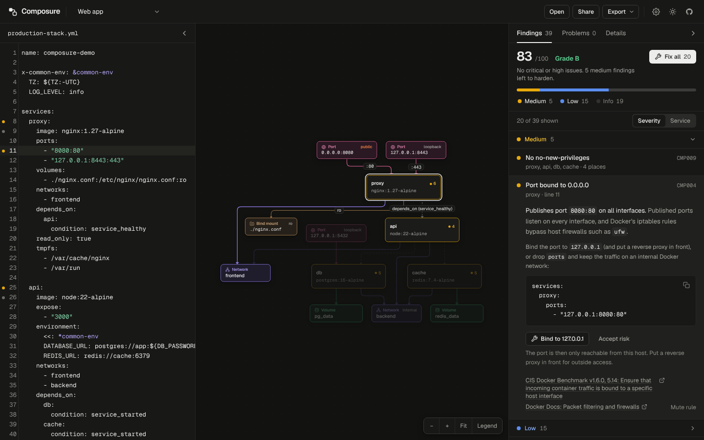
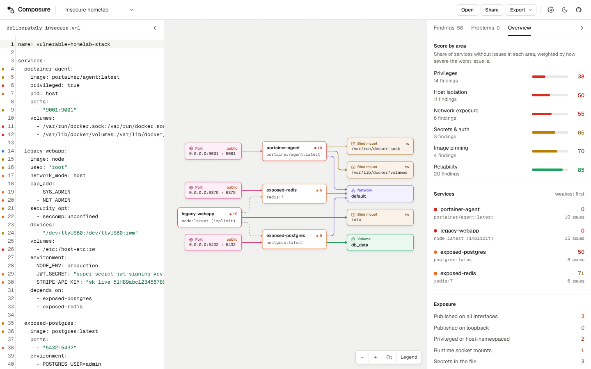

# Composure

**Composure** is an open-source, 100% client-side tool that turns any `docker-compose.yml` into an interactive architecture diagram, checks it for Compose mistakes, and runs a security hardening review against it. The same engine ships as a CLI with SARIF output, so you can run it in CI too.

Paste or drop a Compose file to immediately inspect:
1. **Interactive Topology Diagram**: services, networks (including the implicit `default` network), named volumes, host bind mounts (`ro`/`rw`), published ports (public vs. loopback), `depends_on` and `network_mode: service:` relationships.
2. **Compose Problems**: typos in keys (with "did you mean"), undefined networks/volumes/secrets/services, dependency cycles, host port conflicts, invalid ports, profile and healthcheck dependency traps, and more. These are things `docker compose up` would reject or silently get wrong.
3. **Security Hardening Review**: 21 rules (`CMP001`–`CMP021`) mapped to the CIS Docker Benchmark v1.6.0, with exact YAML line numbers, explanations, safe one-click fixes with a diff preview, and an overall score and grade (`A`–`F`).

---

## Privacy Statement: 100% Client-Side

- **Zero Backend**: Composure runs entirely inside your browser.
- **No External Requests**: the YAML is parsed, laid out, and analyzed locally. Fonts are self-hosted, and the production build ships a strict Content-Security-Policy (`connect-src 'self'`), so the page cannot send your file anywhere, even if a dependency tried to.
- **No Analytics or Telemetry**: no tracking scripts, cookies, or telemetry pings.
- **Serverless Sharing**: **Share** compresses your YAML locally (`deflate-raw`) into the URL `#compose=...` fragment, which browsers never send to a server. Your current draft and muted rules are remembered in your own browser (`localStorage`) only.

---

## Screenshots

| Interactive Topology & Live YAML Editor (Dark Mode) | Security Hardening Findings & Node Inspector (Light Mode) |
| :---: | :---: |
|  |  |

---

## Key Features

- **Full Compose Syntax Normalization**
  - Short and long syntax for `ports`, `volumes`, `networks`, `environment`, `depends_on`, `secrets`, and `configs`
  - YAML anchors (`&`), aliases (`*`), and single/multi merge keys (`<<`)
  - Keeps `${VAR:-default}` interpolations intact, and judges them by their fallback value where that matters (`image: app:${TAG:-latest}` is flagged, `${BIND_IP:-127.0.0.1}` counts as loopback)
  - `network_mode` (`host`, `none`, `service:<name>`, `container:<name>`), `expose` vs `ports`, `tmpfs`, `profiles`, `x-` extension fields
- **Live Editor & Diagram**
  - CodeMirror 6 editor with YAML highlighting, severity gutter markers, inline error/warning squiggles with tooltips, search (`Ctrl/Cmd+F`), and context-aware autocomplete for Compose keys and common values (`Ctrl+Space`)
  - Layered graph layout with `elkjs`, running in a Web Worker so typing never stutters
  - Keeps the last valid diagram while you are mid-edit with invalid YAML
- **Safe Fixes**
  - Fixes are precise text edits, never a rewrite of the file: comments, quoting, and ordering stay as you wrote them
  - Every fix shows a diff preview first and can be undone with `Ctrl/Cmd+Z`
  - Fixes are only offered where they are safe (for example, a value inherited from a YAML anchor is overridden for that one service instead of editing the shared anchor)
- **Accepting Risks**: mute a rule everywhere, or accept a single finding with a `# composure-ignore` comment (see below). Accepted risks stay visible but no longer count toward the score.
- **Export & Sharing**: diagram as **SVG** or high-DPI **PNG**, report as **Markdown** (including Compose problems, per-service scores, and accepted risks), and compressed share links.
- **CLI & CI**: text, JSON, SARIF, and Markdown output, exit codes for pipelines, and a ready-made GitHub Action.

---

## Hardening Rules (`CMP001` to `CMP021`)

CIS numbers refer to the **CIS Docker Benchmark v1.6.0** (as implemented by `docker-bench-security`).

| Rule ID | Severity | Title | What It Checks |
| :--- | :--- | :--- | :--- |
| **`CMP001`** | `critical` | Privileged mode enabled | `privileged: true` (CIS 5.5). |
| **`CMP002`** | `critical` | Docker socket mounted | Mounts of `docker.sock`, and other runtime sockets (`containerd.sock`, `podman.sock`, `crio.sock`), including `:ro` mounts, which do not block API calls (CIS 5.32). |
| **`CMP003`** | `medium` / `info` | Unpinned image tag | `:latest`, a missing tag, or a `${TAG:-latest}` fallback (`medium`); a version tag without an `@sha256:` digest (`info`). Fully interpolated images (`${IMAGE}`) are skipped. |
| **`CMP004`** | `critical` / `high` / `medium` | Port bound to 0.0.0.0 | Ports published on all interfaces, which Docker's iptables rules expose past `ufw` (CIS 5.14). `high` for datastore/admin ports (PostgreSQL, MySQL, Redis, MongoDB, Elasticsearch, etcd, Kafka, ...), `critical` for the unencrypted Docker API (`2375`). Skipped for `network_mode: host`, where `ports` is ignored. |
| **`CMP005`** | `high` | Host namespace shared | `network_mode`, `pid`, `ipc`, `uts`, `userns_mode`, or `cgroup` set to `host` (CIS 5.10, 5.16, 5.17, 5.21, 5.31). |
| **`CMP006`** | `critical` / `high` | Dangerous capability | `cap_add: ALL` (`critical`), and `SYS_ADMIN`, `SYS_MODULE`, `SYS_RAWIO`, `SYS_PTRACE`, `NET_ADMIN`, `DAC_READ_SEARCH`, `BPF`, `MAC_ADMIN`, and others (`high`) (CIS 5.4). |
| **`CMP007`** | `low` | Capabilities not dropped | No `cap_drop: [ALL]` (CIS 5.4). Skipped for privileged services, where `cap_drop` has no effect. |
| **`CMP008`** | `high` | Profile unconfined | `seccomp:unconfined`, `apparmor:unconfined`, `label:disable` (SELinux), or `systempaths=unconfined` (CIS 5.2, 5.3, 5.22). |
| **`CMP009`** | `medium` | No no-new-privileges | No `no-new-privileges:true` in `security_opt` (CIS 5.26). |
| **`CMP010`** | `critical` / `high` | Sensitive host mount | Bind mounts of `/`, `/etc`, `/root`, `/proc`, `/sys`, `/boot`, `/var/lib/docker`, `/run`, `/dev`, whole home directories, and credential folders such as `~/.ssh` or `~/.aws` (`critical` when `rw`, `high` when `ro`) (CIS 5.6). Standard read-only mounts like `/etc/localtime`, `/etc/timezone`, and CA bundles are allowed. |
| **`CMP011`** | `critical` / `high` / `medium` | Host device mapped | `devices` entries (CIS 5.18). `high` for raw disks and `/dev/mem`, `critical` for all of `/dev`. |
| **`CMP012`** | `high` / `medium` | Secret in environment | Literal values for keys like `PASSWORD`, `SECRET`, `TOKEN`, `API_KEY`; passwords inside connection URLs; known token formats (AWS, GitHub, GitLab, Slack, Stripe, Google, OpenAI, Anthropic, private keys); and hardcoded fallbacks like `${DB_PASSWORD:-changeme}` (`medium`). Flags (`"yes"`, `"true"`), file paths, and settings about secrets (`PASSWORD_MIN_LENGTH`, `*_FILE`) are not flagged. |
| **`CMP013`** | `medium` / `info` | User not set | `info` when `user` is omitted (the image default may be root), `medium` when explicitly `root` or `0` (CIS 4.1). |
| **`CMP014`** | `low` | No resource limits | No memory or CPU limit in `deploy.resources.limits` or `mem_limit`/`cpus` (CIS 5.11, 5.12). |
| **`CMP015`** | `low` | Healthcheck not set | No active `healthcheck` (CIS 5.27). |
| **`CMP016`** | `info` | Writable root filesystem | No `read_only: true` (CIS 5.13). |
| **`CMP017`** | `low` | Uncapped container logging | The default `json-file` driver without `max-size`. Drivers that rotate (`local`) or ship logs elsewhere (`journald`, `syslog`, ...) are not flagged. |
| **`CMP018`** | `medium` / `info` | Default bridge network | `network_mode: bridge`, the legacy `docker0` bridge (CIS 5.30). Compose's implicit `default` network is *not* docker0 (it is a project-scoped network with DNS), so a shared default network is only an `info` segmentation hint. |
| **`CMP019`** | `critical` / `high` | Database auth disabled | `POSTGRES_HOST_AUTH_METHOD=trust`, `MYSQL_ALLOW_EMPTY_PASSWORD`, `ALLOW_EMPTY_PASSWORD`, disabled Elasticsearch/OpenSearch security. `critical` when the service is also published on all interfaces. |
| **`CMP020`** | `info` | No PIDs limit | No `pids_limit` / `deploy.resources.limits.pids`, so a fork bomb can exhaust the host (CIS 5.29). |
| **`CMP021`** | `medium` | Shared mount propagation | Bind mounts with `shared` or `rshared` propagation (CIS 5.20). |

### Compose Problems

Besides security findings, the **Problems** tab lists correctness issues:

| Code | Level | Example |
| :--- | :--- | :--- |
| `unknown-key` | warning | `imge:` → *Did you mean `image`?* (services, healthcheck, logging, deploy, build, networks, volumes) |
| `duplicate-key` | error | the same key twice in one mapping |
| `missing-image` | error | a service with neither `image` nor `build` |
| `undefined-service` / `-network` / `-volume` / `-secret` / `-config` | error | a reference to something that is not declared |
| `self-dependency`, `dependency-cycle` | error | `a → b → a` in `depends_on` |
| `invalid-value`, `invalid-port` | error | `condition: service_healty`, port `99999`, protocol `xyz`, mismatched range sizes |
| `port-conflict` | error | two services publishing the same host port and interface |
| `network-mode-conflict`, `ports-ignored` | error / warning | `network_mode` combined with `networks`; `ports` with `network_mode: host` |
| `profile-dependency` | warning | depending on a service that only runs under another profile |
| `healthcheck-dependency` | warning | `service_healthy` on a service without a healthcheck |
| `container-name-replicas`, `duplicate-container-name` | error | a fixed `container_name` with several replicas, or used twice |
| `unquoted-port` | warning | `22:22` unquoted, which YAML 1.1 parsers read as a base-60 number |
| `obsolete-version`, `legacy-links`, `unresolved-extends`, `unresolved-include`, `unused-suppression` | info | housekeeping notes |

---

## Scoring

Each service starts at 100 and loses points per open finding: **critical 30, high 15, medium 6, low 2, info 0**. The project score is the average of the weakest service and the mean of all services, so one bad service drags the grade down, but adding more well-configured services does not. While a critical finding is open the score is capped at **59 (D)**, and a high finding caps it at **74 (C)**.

Grades: `A` ≥ 90, `B` ≥ 75, `C` ≥ 60, `D` ≥ 40, `F` < 40. Accepted risks (below) do not count.

---

## Accepting a Risk Inline

Muting a rule in Settings turns it off everywhere. To accept one specific finding, add a comment. This works in the web app and in the CLI:

```yaml
services:
  traefik:
    volumes:
      # composure-ignore CMP002 -- Traefik reads container labels
      - /var/run/docker.sock:/var/run/docker.sock:ro
    ports:
      - "80:80"  # composure-ignore CMP004

  legacy-app:  # composure-ignore            <- every rule, whole service
    image: vendor/legacy:1.0

# composure-ignore-file CMP016 CMP020        <- whole file
```

A comment on its own line applies to the next line; on (or above) a service name it applies to the whole service. The text after `--` is kept as the reason in reports and SARIF. The **Accept risk** button inserts the comment for you, and comments that no longer match anything show up as `unused-suppression`.

---

## Command-Line Interface

```bash
npm install
npm run build:cli
node dist-cli/composure.mjs docker-compose.yml        # or: npm run composure -- docker-compose.yml
```

```
$ node dist-cli/composure.mjs --min-severity medium docker-compose.yml
docker-compose.yml  Grade C (72/100)  3 services
  Compose problems
  9:1     error    Refers to undefined network backend. Declare it under the top-level networks key. undefined-network
  Security findings
  3       medium   [web] Image uses :latest: Image nginx:latest uses the mutable :latest tag. CMP003
  5       medium   [web] Port bound to 0.0.0.0: Publishes port 8080:80 on all interfaces. CMP004
  11      high     [api] Credentials in URL: DATABASE_URL embeds a literal password in a connection URL. CMP012
  15      high     [db] Database auth disabled: PostgreSQL accepts every connection without a password (POSTGRES_HOST_AUTH_METHOD: trust). CMP019
  ...

✖ 31 findings (0 critical, 2 high, 5 medium, 12 low, 12 info), 1 Compose error
```

| Option | Description |
| :--- | :--- |
| `-f, --format <fmt>` | `text` (default), `json`, `sarif`, `markdown` |
| `-o, --output <file>` | write the report to a file (a short summary still goes to stdout) |
| `--fail-on <level>` | exit 1 if a finding is at least this severe: `critical`, `high` (default), `medium`, `low`, `info`, `none` |
| `--min-severity <level>` | hide findings below this level in text output (default `low`) |
| `--disable <ids>` | skip rules, e.g. `CMP007,CMP016` |
| `--no-fail-on-problems` | do not exit 1 on Compose errors |
| `--list-rules` | print all rules |

Without file arguments it looks for `compose.yaml` / `docker-compose.yml` in the current directory; `-` reads from stdin. Exit codes: `0` clean, `1` threshold reached or Compose errors, `2` usage or read error.

### GitHub Action

```yaml
name: Compose security
on: [push, pull_request]

permissions:
  contents: read
  security-events: write   # to upload SARIF to code scanning

jobs:
  composure:
    runs-on: ubuntu-latest
    steps:
      - uses: actions/checkout@v4
      - uses: VR0EM/composure@main
        with:
          files: docker-compose.yml
          fail-on: high
      - uses: github/codeql-action/upload-sarif@v3
        if: always()
        with:
          sarif_file: composure.sarif
```

Findings then appear as code scanning alerts on the exact lines of your Compose file.

---

## Keyboard Shortcuts

| Shortcut | Action |
| :--- | :--- |
| `Esc` | Close dialogs / clear selection / switch back to Findings |
| `Cmd+O` / `Ctrl+O` | Open a `docker-compose.yml` file |
| `Cmd+S` / `Ctrl+S` | Open the Export menu (SVG, PNG, Markdown) |
| `Cmd+B` / `Ctrl+B` | Toggle the YAML editor panel |
| `Cmd+\` / `Ctrl+\` | Toggle the Findings / Problems / Details panel |
| `Cmd+F` / `Ctrl+F` | Search in the editor |
| `Ctrl+Space` | Autocomplete Compose keys and values |
| `Cmd+Z` / `Ctrl+Z` | Undo (including applied fixes) |

---

## Architecture

The pure TypeScript core is separate from the React UI, and is shared by the web app and the CLI:

- `src/core/` (no React or DOM imports)
  - `parser.ts`, `normalizer.ts`: YAML → normalized `ComposeModel` with line numbers
  - `astDiagnostics.ts`, `composeSchema.ts`, `validator.ts`: Compose problems
  - `rules/`: one file per hardening rule (`CMP001`–`CMP021`), plus `shared.ts` helpers
  - `ruleEngine.ts`: rule execution and scoring
  - `suppressions.ts`: `# composure-ignore` comments
  - `analyze.ts`: one-call parse + validate + rules + suppressions + score
  - `autofix.ts`: safe, minimal text edits for fixes; `textDiff.ts` for previews
  - `graph.ts`, `report.ts`, `sarif.ts`, `share.ts`
- `src/ui/`: React components, CodeMirror 6 integration (`Editor.tsx`, `composeCompletions.ts`), React Flow + ELK diagram (`diagram/`)
- `src/cli/composure.ts`: the command-line interface (built to `dist-cli/composure.mjs`)
- `action.yml`: the GitHub Action
- `tests/`: Vitest suites and YAML fixtures

---

## Running Locally

### Prerequisites
- Node.js 20+ and npm

### Setup & Commands
```bash
npm install          # install dependencies
npm run dev          # start the development server
npm test             # run the Vitest suite
npm run build        # type-check and build the web app
npm run build:cli    # build the CLI into dist-cli/
```

---

## Contributing & License

Contributions and new rules are welcome! See [CONTRIBUTING.md](./CONTRIBUTING.md) for how to add a rule, a fix, and tests.

Released under the [MIT License](./LICENSE).
